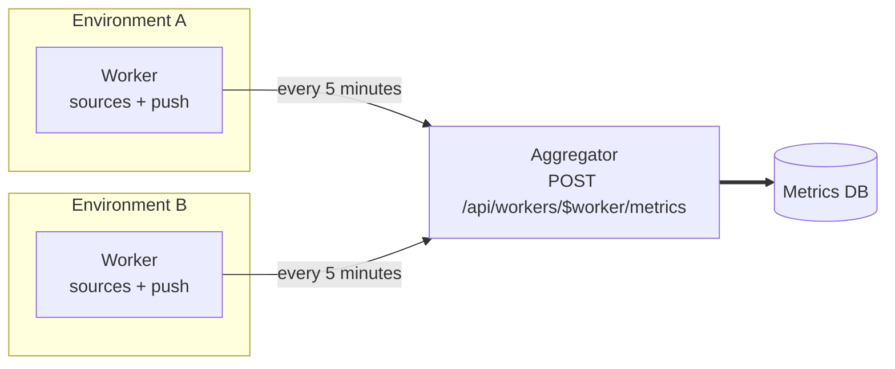

# Distributed setup

A single Wombat can sample every environment it reaches. When environments live in networks it cannot reach (separate
clusters, private VPCs), run a **worker** next to each of them and have them push their metrics to one **aggregator**,
which serves the dashboard and the HTTP API for all of them.



Every instance runs the same image, in one of three modes set by `wombat.mode` (`WOMBAT_MODE`):

| Mode                   | Samples its environments | Writes metrics to   | Accepts `POST /api/workers/{worker}/metrics` |
|------------------------|--------------------------|---------------------|-----------------------------|
| `standalone` (default) | ✓                        | its database        |                             |
| `aggregator`           |                          | its database        | ✓                           |
| `worker`               | ✓                        | the aggregator      |                             |

Outside of the aggregator mode, `POST /api/workers/{worker}/metrics` and `PUT /api/workers/{worker}/environments` answer `404`.

## Aggregator

```sh
WOMBAT_MODE=aggregator
```

An aggregator stores and serves what its workers send: the environments they declare, on
`PUT /api/workers/{worker}/environments`, and the metrics they sample, on `POST /api/workers/{worker}/metrics`. It samples nothing
itself, not even the assets of its own environments file: to also sample environments next to the aggregator, run a
worker there.

The endpoints require the `api.environment.write` and `api.metric.write` permissions: create an API key
holding both for the workers, from the **API keys** page or `POST /api/keys`.

A worker already aggregated its metrics over its own 5-minute sampling window, so the aggregator saves them to its
database as soon as it receives them, as they are, at the start of the worker's window (`window.start`, on the worker's
clock). They are then compacted like any other row (see [compaction](compaction.md)), including those of a window the
aggregator already compacted.

The asset types must be ones the aggregator has an active module for: the metrics of an asset whose type has none are
skipped and reported back to the worker in the response status, while the other metrics of the request are saved. A
malformed request (e.g. an unknown metric family, a missing asset, a missing or reversed window) is still rejected with
`400`, and nothing from it is saved.

### Declared environments

Each asset belongs to the declaration it comes from: the aggregator's own `monitor.environments-file`, or one worker.
The aggregator identifies the assets of a worker as `workerId.assetId` (e.g. `east.cluster`): two workers declaring the
same asset id declare two assets, listed apart on the dashboard, whose metrics stay apart. The metrics a worker pushes
go to its own assets the same way.
Declarations can share an environment: the aggregator's file typically holds the assets without a source, such as
Anthropic, whose activity is queried from its usage API by the instance evaluating it, next to the clusters a worker
declares in the same environment.

* A worker's declaration replaces its previous one: the assets it no longer declares are deleted, the others created or
  updated, with their history recorded like those of the file.
* Declaring an asset whose `workerId.assetId` the aggregator's file already declares is rejected with `409`, and nothing
  from that declaration is applied. The aggregator's file takes over such assets at its next startup instead.
* A worker only declares assets it samples: each must have an asset type the aggregator has a module for, and be
  monitorable. Anything else (an unknown type, an asset without a source such as Anthropic) is rejected with `400`, and
  nothing from that declaration is applied. Assets without a source belong in the aggregator's file.
* An asset whose module the aggregator disabled is still declared: its metrics are skipped when pushed, see above.
* The aggregator does not check the secrets of declared assets: those of a sampled asset (e.g. a Prometheus password)
  are used by its source, on the worker, and the aggregator does not need to know them.
* An environment is disabled once no declaration holds it, nor any of its assets.

## Workers

A worker samples its environments as usual, declares them to the aggregator, and writes the metrics of each closed
window to the aggregator instead of its database:

```sh
WOMBAT_MODE=worker
WOMBAT_WORKER_ID=east                 # owner of its declarations: unique among the workers, lowercase letters, digits, '_', '-'
WOMBAT_WORKER_AGGREGATOR_URL=https://wombat-aggregator.example.com
WOMBAT_WORKER_AGGREGATOR_API_KEY=<key holding api.metric.write and api.environment.write on the aggregator>
WOMBAT_WORKER_AGGREGATOR_TIMEOUT=30s  # optional, connect and read timeout of each request
WOMBAT_WORKER_AGGREGATOR_PROXY_URL=http://proxy.example.com:3128  # optional, HTTP proxy to reach the aggregator through
```

The aggregator cannot tell two workers sharing an id apart: each declaration replaces the other's assets, and their
metrics are mixed. Give every worker its own id.

A worker declares its whole `monitor.environments-file` at startup, then again every minute: declaring unchanged
environments changes nothing, and an aggregator started after its workers, or restored from a backup, catches up within
a minute. A declaration that fails is logged, and the next one tries again. Removing an asset from the worker's file
removes it from the aggregator at the worker's next startup.

No metric is written to the worker's database, so a worker always runs on an in-memory SQLite database, whatever its
`persistence.backend.mode` setting, and logs a warning when the configured backend is another
one: it needs no database file, and loses its users and API keys at each restart.

Each window is sent in at most one request per metric family. A push that fails (aggregator unreachable, rejected key)
is retried a few times on network errors, then logged and dropped: the worker does not buffer windows it could not send.

## Running it locally

[`compose/demo-distributed/compose.yaml`](../compose/demo-distributed/compose.yaml) runs a ready-made setup: an aggregator on port `8080` and two workers, `east` on `8081` and `west` on `8082`, next to the Boavizta and Ecologits APIs.
Each instance reads its `monitored-environments.yaml` from its own directory of `compose/demo-distributed`:

| Instance      | Samples        | Declares                      |
|---------------|----------------|-------------------------------|
| `aggregator`  | nothing        | `east-anthropic` in `east`    |
| `worker-east` | `east-cluster` | `east.east-cluster` in `east` |
| `worker-west` | `west-cluster` | `west.west-cluster` in `west` |

The Anthropic asset has no source, so the aggregator declares it itself, and needs its admin key. Workers only need
what their sources use.

1. Create the environments of each instance from its template, then edit the clusters (`namespace`, `profile`) and the
   Anthropic asset to match yours:
   ```sh
   for node in aggregator worker-east worker-west; do
     cp compose/demo-distributed/$node/monitored-environments.yaml.dist compose/demo-distributed/$node/monitored-environments.yaml
   done
   ```
2. Give each worker the kubeconfig of its cluster: `compose/demo-distributed/worker-east/kubeconfig/east.config.yaml` and
   `compose/demo-distributed/worker-west/kubeconfig/west.config.yaml`. The aggregator never reads them.
3. Start the setup, from the latest `illuin/wombat` image of Docker Hub:
   ```sh
   ANTHROPIC_ADMIN_KEY=<admin key> docker compose -f compose/demo-distributed/compose.yaml up
   ```
   The aggregator does not start without the admin key, since its environments file declares the Anthropic asset.
   Its database lands in `compose/demo-distributed/aggregator/data`.
4. Open the aggregator's dashboard at http://localhost:8080. The clusters are listed as soon as their worker started,
   and show activity once a window went all the way through, about 10 to 15 minutes after the start:
   * each worker samples every 10 seconds, and pushes each 5-minute window after it closes (Micrometer publishes at a
     random point of the following window);
   * the aggregator saves what it received right away, at the start of the worker's window;
   * its compaction, set to 5-minute windows in `compose.yaml`, folds the rows a minute later.

   Meanwhile, `http://localhost:8081/q/metrics` (or `8082`) shows what a worker sampled in its window in progress,
   under `wombat_k8s_*`.

The aggregator runs without authentication here, so the workers' API key is a placeholder. To try it with
authentication, enable the `oidc` profile on the aggregator (see [access control](access-control.md)), create a key
holding `api.metric.write` and `api.environment.write` on its **API keys** page, and start the setup with it as
`WOMBAT_WORKER_API_KEY`.

### Running the aggregator in dev mode

For development purposes, you can use this sample distributed configuration to your advantage by running the aggregator as a dev instance, and launching workers as configured in the docker compose demo:

```sh
./mvnw quarkus:dev -Dwombat.mode=aggregator -Dmonitor.environments-file=compose/demo-distributed/aggregator/monitored-environments.yaml ;

WOMBAT_AGGREGATOR_URL=http://host.docker.internal:8080 docker compose -f compose/demo-distributed/compose.yaml up --no-deps worker-east worker-west ;
```
