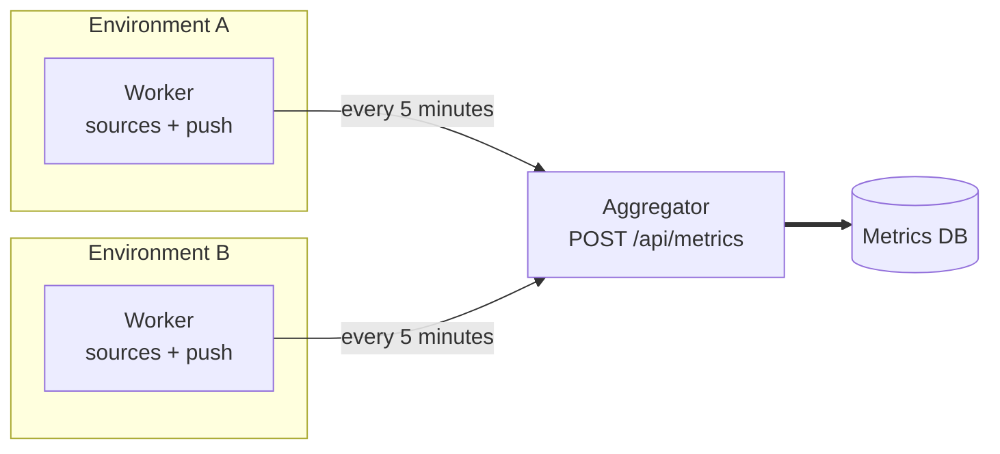

# Distributed setup

A single Wombat can sample every environment it reaches. When environments live in networks it cannot reach (separate
clusters, private VPCs), run a **worker** next to each of them and have them push their metrics to one **aggregator**,
which serves the dashboard and the HTTP API for all of them.



Every instance runs the same image, in one of three modes set by `wombat.mode` (`WOMBAT_MODE`), or by the `--mode`
argument, which takes precedence (e.g. `java -jar quarkus-run.jar --mode worker`, or `command: ["--mode", "worker"]`
in a compose file):

| Mode                   | Samples its environments | Writes metrics to   | Accepts `POST /api/metrics` |
|------------------------|--------------------------|---------------------|-----------------------------|
| `standalone` (default) | ✓                        | its database        |                             |
| `aggregator`           |                          | its database        | ✓                           |
| `worker`               | ✓                        | the aggregator      |                             |

### Features

The mode also sets which functionalities an instance serves:

| Feature                       | Serves                                                                  | `standalone` | `aggregator` | `worker` |
|-------------------------------|-------------------------------------------------------------------------|--------------|--------------|----------|
| `ui`                          | the web UI and its dashboards, `GET /api/app`                           | ✓            | ✓            |          |
| `api-read`                    | `/api/impact`, `/api/simulation`, `/api/environments`                   | ✓            | ✓            |          |
| `api-write`                   | `POST /api/metrics`, `PUT /api/workers/{worker}/environments`           |              | ✓            |          |
| `admin`                       | `/api/users`, `/api/keys`, `/api/secrets`                               | ✓            | ✓            |          |

A disabled feature answers `404`, and `/q/*` is never gated: by default, a worker serves nothing else, so it needs no
authentication. The features are served as [quarkus-flags](https://docs.quarkiverse.io/quarkus-flags/dev) flags
named after them, resolved once at startup and logged.

## Aggregator

```sh
WOMBAT_MODE=aggregator
```

An aggregator stores and serves what its workers send: the environments they declare, on
`PUT /api/workers/{worker}/environments`, and the metrics they sample, on `POST /api/metrics`. It samples nothing
itself, not even the assets of its own environments file: to also sample environments next to the aggregator, run a
worker there.

The endpoints require the `api.environment.write` and `api.metric.write` permissions: create an API key
holding both for the workers, from the **API keys** page or `POST /api/keys`.

Pushed metrics are staged exactly like those of the aggregator's own sources: they are aggregated in its 5-minute
sampling windows, written to its database, then compacted (see [compaction](compaction.md)). A pushed sample therefore
lands in the aggregator's window in progress when it is received, at most one window after it was sampled.

The asset types must be ones the aggregator has a module for: a push for an unknown asset type is rejected with `400`
and nothing from that request is staged.

### Declared environments

Each asset belongs to the declaration it comes from: the aggregator's own `monitor.environments-file`, or one worker.
Declarations can share an environment: the aggregator's file typically holds the assets without a source, such as
Anthropic, whose activity is queried from its usage API by the instance evaluating it, next to the clusters a worker
declares in the same environment.

- A worker's declaration replaces its previous one: the assets it no longer declares are deleted, the others created or
  updated, with their history recorded like those of the file.
- Declaring an asset that the aggregator's file or another worker already declares is rejected with `409`, and nothing
  from that declaration is applied. The aggregator's file takes over such assets at its next startup instead.
- A worker only declares assets it samples: each must have an asset type the aggregator has an active module for, and
  be monitorable. Anything else (an unknown type, a disabled module, an asset without a source such as Anthropic) is
  rejected with `400`, and nothing from that declaration is applied. Assets without a source belong in the
  aggregator's file.
- The aggregator does not check the secrets of declared assets: those of a sampled asset (e.g. a Prometheus password)
  are used by its source, on the worker, and the aggregator does not need to know them.
- An environment is disabled once no declaration holds it, nor any of its assets.

## Workers

A worker samples its environments as usual, declares them to the aggregator, and writes the metrics of each closed
window to the aggregator instead of its database:

```sh
WOMBAT_MODE=worker
WOMBAT_WORKER_ID=east                 # owner of its declarations: unique among the workers, letters, digits, '.', '_', '-'
WOMBAT_WORKER_AGGREGATOR_URL=https://wombat-aggregator.example.com
WOMBAT_WORKER_AGGREGATOR_API_KEY=<key holding api.metric.write and api.environment.write on the aggregator>
WOMBAT_WORKER_AGGREGATOR_TIMEOUT=30s  # optional, connect and read timeout of each request
WOMBAT_WORKER_AGGREGATOR_PROXY_URL=http://proxy.example.com:3128  # optional, HTTP proxy to reach the aggregator through
```

A worker declares its whole `monitor.environments-file` at startup, then again every minute: declaring unchanged
environments changes nothing, and an aggregator started after its workers, or restored from a backup, catches up within
a minute. A declaration that fails is logged, and the next one tries again. Removing an asset from the worker's file
removes it from the aggregator at the worker's next startup.

No metric is written to the worker's database, so a worker always runs on an in-memory SQLite database, whatever its
`quarkus.datasource.jdbc.url`: it needs no database file, and loses its users and API keys at each restart. A worker
refuses to start on any other `quarkus.datasource.db-kind`, which is fixed at build time: run workers from a SQLite
build. Its compaction runs on empty tables, and its dashboard stays empty.

Each window is sent in at most one request per metric family. A push that fails (aggregator unreachable, rejected key)
is retried a few times on network errors, then logged and dropped: the worker does not buffer windows it could not send.

## Running it locally

[`compose/distributed`](../compose/distributed) holds a ready-made setup: an aggregator on port `8080` and two workers,
`east` on `8081` and `west` on `8082`. Each one runs from its own directory, which holds the aggregator's database (`data/`), its
`config/application.yaml` (read by Quarkus from the working directory) and its `monitored-environments.yaml`:

| Instance      | Samples        | Declares                   |
|---------------|----------------|----------------------------|
| `aggregator`  | nothing        | `east-anthropic` in `east` |
| `worker-east` | `east-cluster` | `east-cluster` in `east`   |
| `worker-west` | `west-cluster` | `west-cluster` in `west`   |

The Anthropic asset has no source, so the aggregator declares it itself, and needs its admin key. Workers only need
what their sources use.

1. Package Wombat:
   ```sh
   ./mvnw package -DskipTests
   ```
2. Create the configuration of each instance from its template, then edit the clusters (`namespace`, `profile`) and
   the Anthropic asset to match yours:
   ```sh
   cd compose/distributed
   for node in aggregator worker-east worker-west; do
     cp $node/config/application.yaml.dist $node/config/application.yaml
     cp $node/monitored-environments.yaml.dist $node/monitored-environments.yaml
   done
   ```
3. Give each worker the kubeconfig of its cluster: `worker-east/kubeconfig/east.config.yaml` and
   `worker-west/kubeconfig/west.config.yaml`. The aggregator never reads them.
4. Start each instance from its directory, in three terminals:
   ```sh
   cd compose/distributed/aggregator  && ANTHROPIC_ADMIN_KEY=<admin key> java -jar ../../../target/quarkus-app/quarkus-run.jar --mode aggregator
   cd compose/distributed/worker-east && java -jar ../../../target/quarkus-app/quarkus-run.jar --mode worker
   cd compose/distributed/worker-west && java -jar ../../../target/quarkus-app/quarkus-run.jar --mode worker
   ```
   The admin key can also come from a secrets directory or the database secret store, see the aggregator's
   `application.yaml`.
5. Open the aggregator's dashboard at http://localhost:8080. The clusters are listed as soon as their worker started,
   and show activity once a window went all the way
   through, about 10 to 15 minutes after the start:
   - each worker samples every 10 seconds, and pushes each 5-minute window after it closes (Micrometer publishes at a
     random point of the following window);
   - the aggregator writes what it received when its own window closes;
   - its compaction, set to 5-minute windows like in dev mode, folds the rows a minute later.

   Meanwhile, `http://localhost:8081/q/metrics` (or `8082`) shows what a worker sampled in its window in progress, and
   `http://localhost:8080/q/metrics` what the aggregator received, under `wombat_k8s_*`.

The aggregator runs without authentication here, so the workers' `api-key` is a placeholder. To try it with
authentication, start the aggregator with the `oidc` profile (see [access control](access-control.md)), create a key
holding `api.metric.write` and `api.environment.write` on its **API keys** page, and set it as `wombat.worker.aggregator.api-key` of both workers.

### With the dev mode as aggregator

The packaged application is built for SQLite (`quarkus.datasource.db-kind` is fixed at build time). To use your dev
configuration instead (PostgreSQL, sign-in, local connectors), run the aggregator in dev mode from the repository root,
with an environments file holding only what no worker declares:

```sh
./mvnw quarkus:dev -Dquarkus.args="--mode aggregator" -Dmonitor.environments-file=compose/distributed/aggregator/monitored-environments.yaml
```

## Request formats

`PUT /api/workers/{worker}/environments` takes the same environments as a `monitor.environments-file`, in JSON:

```json
{
  "environments": {
    "east": {
      "id": "east",
      "assets": [
        {"type": "tech.illuin.wombat-module.kubernetes-api", "id": "east-cluster", "environmentId": "east", "name": "East Cluster", "configPath": "kubeconfig/east.config.yaml", "namespace": "default", "profile": {"provider": "aws", "instanceType": "c5.xlarge", "location": "FRA", "lifespan": "5y"}}
      ]
    }
  }
}
```

The response payload counts the created, updated and deleted assets.

`POST /api/metrics` takes a list of the metrics sampled per asset. Each metric carries its family in a `family` property, which
selects its variant:

```json
[
  {
    "asset": {"id": "prod-cluster", "environmentId": "prod", "name": "Production cluster"},
    "assetType": "tech.illuin.wombat-module.kubernetes-api",
    "metrics": [
      {"family": "KUBERNETES_CONTAINER", "serviceId": "api", "cluster": "prod", "namespace": "default", "pod": "api-7d9f", "cpuNanocores": 125000000.0, "ramBytes": 268435456.0}
    ]
  },
  {
    "asset": {"id": "assistant", "environmentId": "prod", "name": "Assistant"},
    "assetType": "tech.illuin.wombat-module.llm-prometheus",
    "metrics": [
      {"family": "LLM", "serviceId": "chat", "provider": "mistralai", "model": "mistral-large-latest", "location": "FRA", "outputTokens": 1200, "requests": 4}
    ]
  }
]
```

The response payload is the number of staged metrics.
