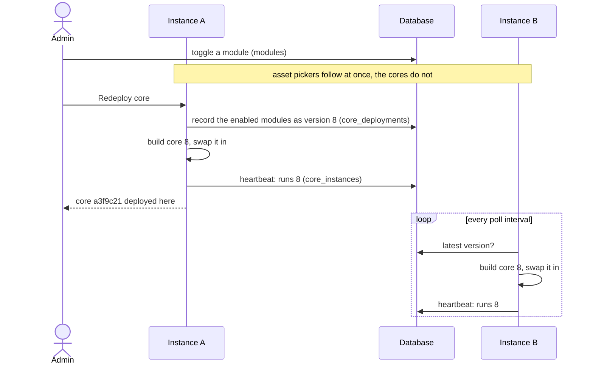

# Modules and core deployments

A **module** either provides an asset type, how its assets are described, sampled and evaluated, or serves every asset
of a family as a **family module**, e.g. the Boavizta and Ecologits impact estimations. For each part of an asset's
evaluation, the module of its asset type comes first, then the family modules of its family, in the
[order of the modules](#the-order-of-the-modules). Wombat ships with core
modules, and loads [custom ones](../README.md#custom-extensions) from the jars of its extension folder. The **core** is
what monitors and evaluates assets: it is built out of the enabled modules, and rebuilt on each **redeploy**.

Modules are managed from **Settings > Modules**, or through `api/modules`.

## The registry

Each instance detects its modules once, at startup: the core modules, and those of the jars found in
`wombat.module.extension.path`. A jar added or removed later is only seen after a restart.

Every detected module is **registered** in the database, enabled, along with the type it advertises: an asset type, or
the family a family module serves. Its state is then the registry's, shared by every instance:

| State        | Meaning                                                                                                                  |
|--------------|--------------------------------------------------------------------------------------------------------------------------|
| **Enabled**  | Offered in the asset pickers, and held by the next core deployed.                                                       |
| **Disabled** | Hidden from the asset pickers, and left out of the next core deployed. Its assets are kept, and still accepted.         |
| **Missing**  | Registered, but no live instance detects it any more, e.g. its jar was removed. It keeps its state, but is unusable. |

A family module defines no asset, so it is never offered in the asset pickers, and has no schema. Disabling one leaves
its family without what it provided: e.g. with `kubernetes-metrics` disabled, the sourced Kubernetes assets get no
activity, and are not evaluated.

A missing module comes back as it was when its jar does. It can also be deleted, in which case Wombat will forget its state: should its jar come back, it is registered once again, and enabled. A detected module cannot be deleted.

A module detected by another instance, but not by the one serving a page, is not considered missing: that instance only lacks its classes, so it cannot show its schema, nor validate its assets.

## The order of the modules

The registered modules have an order, which **Settings > Modules** lists them in, as `GET /api/modules` does. For each
part of an asset's evaluation, the family modules of its family are tried in that order, after the module of its asset
type wherever it stands: the first one which accepts the asset serves it. Two family modules only compete for what they
both provide, as the Provides column tells: e.g. `kubernetes-metrics` resolves the activity of Kubernetes containers,
and `boavizta` their impacts, so their order changes nothing. An extension estimating those impacts too, placed before
`boavizta`, takes precedence over it, and leaves it the assets it does not accept.

A module registered for the first time comes last: the modules Wombat ships first, then those of the extension jars, in
the order of their file names, and within a jar in the order of its `META-INF/services` file. Disabled and missing
modules keep their place.

An admin moves a module up or down from Settings > Modules, while the list is neither searched nor filtered, or sets the
whole order through `PUT /api/modules/order`. Like a toggle, a new order reaches the core on the next redeploy.

## What a toggle or a reorder changes, and when

| Where                                                              | When                                                                    |
|--------------------------------------------------------------------|-------------------------------------------------------------------------|
| The asset pickers of the environment pages                         | At once                                                                 |
| The metrics workers push to an aggregator                          | At once: those of a disabled module are skipped      |
| Assets declared by a worker, or created through the API            | Never: they are accepted whatever the module's state                    |
| Monitoring (sampling) and evaluation (Impact / Cost estimation) | After a core redeploy, on every instance                                |
| The order the family modules are tried in                          | After a core redeploy, on every instance                                |

Only a redeploy applies toggles and the order to the core, **even across restarts**: a restarted instance runs the
latest deployment, not the registry. The one exception is a module registered for the first time, e.g. one a new
version of Wombat ships: being enabled, it is added at the end of the deployment at that startup, which records a new
version the other instances converge on. The modules of a new extension jar do the same, unless
`wombat.module.extension.auto-deploy` is `false`: they then wait for a redeploy, like a toggle. The modules Wombat ships
always go live, so that an upgrade leaves no asset unserved. Settings > Modules tells the changes not deployed yet, and
which core each instance runs.

## Core deployments

### Redeploying

**Redeploy core** (`POST /api/modules/deployment`) records the modules enabled at that moment, in their order, under
the next version, then deploys it on the instance which received the request.

Deploying builds a new core and swaps it in: the calls already running finish on the previous core, which is closed a
minute later.

A redeploy resets the evaluation caches, and starts sampling afresh, as a restart does: a sampling run in progress during the swap may overlap the first run of the new core.

A redeploy with no change still rebuilds every core, which resets the caches and retries the instances that failed.

### Replicas

The database is the only channel between instances. Each instance:
* deploys the latest version at startup; the first one to start records version 1 out of the registry;
* every `wombat.module.deployment.poll-interval`, deploys the latest version if it runs an older one, and writes a
  **heartbeat**: the version it runs, whether the latest one failed to build there, and the modules it detects.

Replicas thus converge on a redeploy within one poll interval. An instance which missed three heartbeats is considered gone: it is no longer listed, nor counted to tell whether a module is missing. Versions only go forward: an instance never deploys a version older than the one it runs.

Instances detecting different modules, because their extension folders differ, are flagged on the Modules page. A
deployment requesting a module an instance does not detect is still deployed there, without that module, which the
heartbeat reports.

### Failures

A core that fails to build is not swapped in: the instance keeps running its previous core, and its heartbeat reports
the failure and associated error, shown on the Modules page.
The poll does not retry a version that failed: fix the cause, then redeploy. Should the build fail at startup, the instance will not start at all, since there is no previous core to keep running.

Two redeploys requested at the same time on two instances record the same version once: the second gets `409`, and
every instance converges on the first.

### Workers

A [worker](distributed.md#workers) has no UI nor API, and its database is in memory: it enables every module it detects,
in the order it detects them, deploys its core at startup, and neither polls nor writes a heartbeat. It only declares
the assets it samples. To skip the metrics of a module, disable it on the aggregator.

## Configuration

| Setting                                  | Environment variable                     | Default              | Description                                                   |
|------------------------------------------|------------------------------------------|----------------------|---------------------------------------------------------------|
| `wombat.module.extension.path`           | `WOMBAT_MODULE_EXTENSION_PATH`           | `extensions`         | Folder whose jars are loaded as modules, at startup           |
| `wombat.module.deployment.poll-interval` | `WOMBAT_MODULE_DEPLOYMENT_POLL_INTERVAL` | `30s`                | How often an instance deploys the latest core, and heartbeats |
| `wombat.module.deployment.instance-id`   | `WOMBAT_MODULE_DEPLOYMENT_INSTANCE_ID`   | `${HOSTNAME:wombat}` | Identifies an instance among the replicas                     |

The instance id is the pod name in Kubernetes, and `wombat` when `HOSTNAME` is unset: a restarted instance takes its
heartbeat back. Under plain Docker, `HOSTNAME` is the container id, which changes when the container is recreated; set the instance id to keep it.

## API and permissions

| Route                           | Permission          | Does                                                                      |
|---------------------------------|---------------------|---------------------------------------------------------------------------|
| `GET /api/modules`, `GET /{id}` | `api.module.read`   | The modules in their order, their state, whether the core serving the request holds them |
| `GET /api/modules/{id}/schema`  | `api.module.read`   | The JSON schema of the module's assets                                    |
| `PUT /api/modules/{id}`         | `api.module.manage` | Enables or disables a module (`{"enabled": false}`); `409` if missing     |
| `DELETE /api/modules/{id}`      | `api.module.manage` | Deletes a missing module; `409` if detected                               |
| `PUT /api/modules/order`        | `api.module.manage` | Sets the order of the modules (`{"modules": [...]}`); `400` unless it lists each registered module once |
| `GET /api/modules/deployment`   | `api.module.read`   | The latest deployment, the live instances, the changes not deployed       |
| `POST /api/modules/deployment`  | `api.module.manage` | Redeploys the core; `409` if another redeploy was requested at once       |

`api.module.manage` is held by admins, and can be granted to API keys. The Modules pages need `ui.modules.read`, held by every role; toggling, reordering, redeploying and deleting from them also need `ui.modules.manage`, held by admins. See
[access control](access-control.md).
